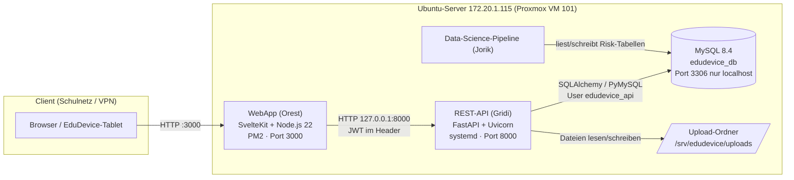
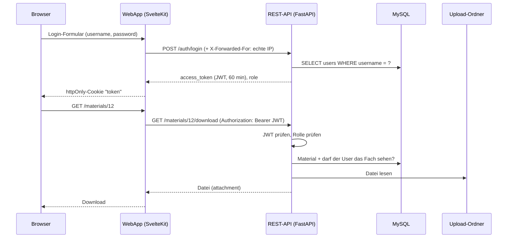
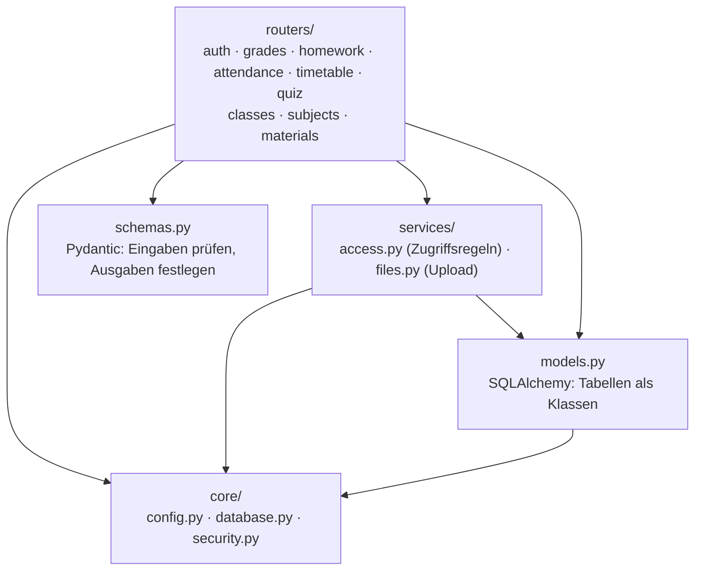

# EduDevice – Architektur Backend (REST-API)

Verantwortlich: Gridi Bushati · Stand: 11.10.2026 · API-Version 2.3 · Schema V4.3

## 1. Gesamtsystem

**Grundregel (Ziel-M-2):** Nur die REST-API spricht mit der Datenbank. Die WebApp hat keinen eigenen
MySQL-Zugang mehr, sie ruft die API auf. Damit gibt es genau eine Stelle, an der Rechte geprüft werden.

## 2. Ablauf einer Anfrage (Beispiel: Schüler lädt Material herunter)

## 3. Schichten in der API (Ordner `backend/app`)

| Schicht | Datei(en) | Aufgabe |
|---|---|---|
| Router | `app/routers/*.py` | Endpunkte, eine Datei pro Bereich. Nur „was passiert bei welcher URL“. |
| Schemas | `app/schemas.py` | Prüft Eingaben (z. B. Note 4–10, Rolle nur schueler/lehrkraft) → sonst 422. Legt fest, was zurückkommt (nie `password_hash`). |
| Services | `app/services/access.py` | Wer darf was sehen/ändern. Wird von mehreren Routern benutzt, damit die Regeln überall gleich sind. |
|  | `app/services/files.py` | Upload prüfen (Typ, Größe), mit UUID-Namen speichern, löschen. |
| Models | `app/models.py` | Tabellen als Python-Klassen (ORM). Die Tabellen selbst legt das SQL-Schema an, nicht die API. |
| Core | `app/core/config.py` | Alle Einstellungen aus Umgebungsvariablen (keine Passwörter im Code). |
|  | `app/core/database.py` | Verbindung zu MySQL, eine Session pro Anfrage. |
|  | `app/core/security.py` | bcrypt, JWT, Rollenprüfung, Rate-Limiter. |

## 4. Sicherheit

| Maßnahme | Umsetzung |
|---|---|
| Passwörter | nur als bcrypt-Hash gespeichert |
| Authentifizierung | JWT (HS256), 60 min gültig, Schlüssel nur in `api.env` |
| Autorisierung | Rollen `schueler` / `lehrkraft` / `admin`; Lehrkraft nur eigene Fächer; Schüler nur eigene Daten |
| Kein Informationsleck | fremdes Fach → 404 statt 403; gleiche Fehlermeldung bei falschem User und falschem Passwort |
| Brute-Force | Login 10/min, Register 5/min pro IP; echte IP wird von der WebApp weitergegeben, Header nur von localhost akzeptiert |
| Uploads | Whitelist der Endungen, max. 50 MB, zufälliger UUID-Name, Ordner außerhalb des Web-Roots, MIME aus der Endung |
| SQL-Injection | nur ORM / gebundene Parameter, kein zusammengesetztes SQL |
| Geheimnisse | `api.env` (chmod 600) und `.env` stehen in `.gitignore` |
| DB-Rechte | API-User `edudevice_api` hat nur SELECT/INSERT/UPDATE/DELETE, kein DROP/ALTER |

**Noch offen (Ziel-M-3):** nginx als Reverse-Proxy mit HTTPS, Firewall (ufw): Port 3306 und 8000 von außen sperren.

## 5. Datenbank

Schema V4.2 (Jorik/Gridi) + Migration V4.3 (`sql/migration_v4_3.sql`):

- `class_subject_students` – welche Schüler in welchem Fach eingetragen sind
- `materials` – Metadaten der Lernmaterialien (Datei liegt im Upload-Ordner)

Beide hängen mit `ON DELETE CASCADE` an `class_subjects`. Noten, Quizzes und `period_grades` hängen
**ohne** CASCADE dran, damit beim Löschen eines Fachs keine Noten verloren gehen (API antwortet dann 409).

## 6. Endpunkte (32)

| Bereich | Methode + Pfad | Rolle |
|---|---|---|
| **Ziel-M-4** | `POST /auth/login` | alle |
|  | `GET /grades/{student_id}` · `POST /grades` | alle (gefiltert) · lehrkraft, admin |
|  | `GET /homework/{subject_id}` · `POST /homework/confirm` | alle (gefiltert) · schueler |
|  | `GET /attendance/{class_id}/{date}` · `POST /attendance` | lehrkraft, admin |
|  | `GET /timetable/{user_id}` | eigener / admin |
|  | `POST /quiz/submit` | schueler |
| **Auth** | `POST /auth/register` · `GET /auth/me` | alle |
| **Klassen** | `GET /classes` | lehrkraft, admin |
|  | `GET /classes/{id}` · `GET/POST /classes/{id}/students` · `DELETE /classes/{id}/students/{sid}` · `GET /classes/{id}/assignable-students` | admin |
| **Fächer** | `GET /subjects` · `GET /subjects/{id}` | alle (gefiltert) |
|  | `POST /subjects` · `DELETE /subjects/{id}` | lehrkraft (eigene) |
|  | `GET /subjects/names` | lehrkraft, admin |
|  | `GET/POST /subjects/{id}/students` · `DELETE /subjects/{id}/students/{sid}` · `GET /subjects/{id}/addable-students` | lehrkraft des Fachs |
| **Materialien** | `GET /subjects/{id}/materials` · `GET /materials/recent` · `GET /materials/{id}/download` · `GET /materials/config` | alle mit Zugriff |
|  | `POST /subjects/{id}/materials` · `DELETE /subjects/{id}/materials/{mid}` | lehrkraft des Fachs |
| **Info** | `GET /` · `GET /health` · `GET /docs` | öffentlich |

## 7. Tests

`tests/test_api.py` – 15 automatische Tests (eigene SQLite-Testdatenbank, MySQL wird nicht angefasst):
Login, Rechte pro Rolle, alle Ziel-M-4-Endpunkte, Klassenzuteilung, Fach anlegen/löschen, Upload
(erlaubt/verboten/zu wenig Rechte), Download, Rate-Limit-IP.

`postman/` – Postman-Collection mit 66 Requests und 162 Prüfungen (davon 29 Negativtests) gegen die laufende API,
plus Rate-Limit-Test. Details: [postman/POSTMAN.md](postman/POSTMAN.md).
