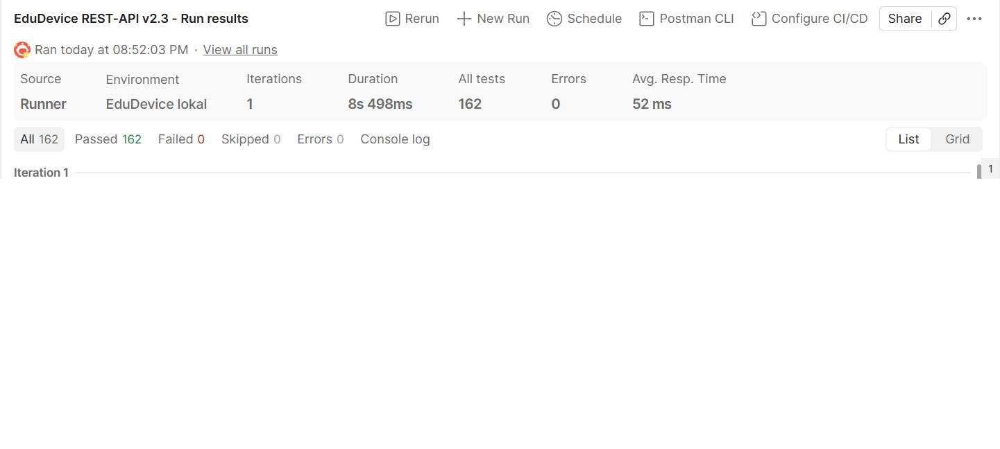

# Postman-Tests – EduDevice REST-API v2.3

Autor: Gridi Bushati · Stand: 11.10.2026

## Inhalt dieses Ordners

| Datei | Zweck |
|---|---|
| `EduDevice_API.postman_collection.json` | Haupt-Collection: 66 Requests, 162 automatische Prüfungen |
| `EduDevice_RateLimit.postman_collection.json` | Zeigt den Brute-Force-Schutz (Login wird nach 10 Fehlversuchen gesperrt) |
| `EduDevice_lokal.postman_environment.json` | Einstellungen für die API auf dem eigenen Laptop (`127.0.0.1:8000`) |
| `EduDevice_Server.postman_environment.json` | Einstellungen für den Schulserver (`172.20.1.115:8000`, VPN nötig) |
| `files/testdatei.pdf`, `files/verboten.html` | Testdateien für den Upload (erlaubt / nicht erlaubt) |

## Ausführen in Postman

1. Postman öffnen → **Import** → alle `.json`-Dateien aus diesem Ordner auswählen.
2. **Settings (Zahnrad) → General → Working directory** auf diesen Ordner (`backend/postman`) setzen.
   Sonst findet Postman die Testdateien für den Upload nicht.
3. Oben rechts das Environment wählen: **EduDevice lokal** oder **EduDevice Server**.
4. Collection **EduDevice REST-API v2.3** → **Run** → **Run EduDevice REST-API v2.3**.
5. Ergebnis: alle Prüfungen grün.

Die API muss laufen und die Testdaten müssen da sein (`python -m scripts.seed`).

## Ausführen über die Kommandozeile (Newman)

```
npm install -g newman newman-reporter-htmlextra
cd backend/postman
newman run EduDevice_API.postman_collection.json -e EduDevice_lokal.postman_environment.json -r cli,htmlextra --reporter-htmlextra-export testbericht.html
```

`testbericht.html` ist ein Testbericht zum Ausdrucken bzw. für die Dokumentation.

## Wichtig

- **Zwischen zwei Läufen 1 Minute warten.** Ein Lauf macht 6 Logins und 4 Registrierungen. Bei zwei Läufen
  direkt hintereinander greift das Rate-Limit (Login 10/min, Register 5/min) und die API antwortet mit 429.
  Das ist gewollt, siehe Rate-Limit-Test.
- Die Requests hängen voneinander ab (Login speichert den Token, „Fach anlegen“ speichert die ID, …).
  Deshalb die **ganze Collection** mit dem Runner ausführen, nicht einzelne Requests.
- Jeder Lauf legt eine neue Test-Schülerin `pm<Zahl>` an (es gibt keinen Endpunkt zum Löschen von Benutzern).
  Das Testfach und die Testdatei werden am Ende wieder gelöscht.
- Die IDs (Klasse, Fach, Stunde, …) stehen im Environment. Auf dem Server sind sie anders als lokal.

## Was getestet wird

Jeder Request prüft den **Statuscode** und die **Antwortzeit (< 1000 ms)**, die meisten zusätzlich den Inhalt.
29 der 66 Requests sind **Negativtests**: Sie prüfen, dass etwas verboten ist (401, 403, 404, 409, 422).

| Ordner | Requests | davon Negativtests | Was geprüft wird |
|---|---|---|---|
| 0 Info | 2 | 0 | API läuft, Datenbank antwortet (`/health`) |
| 1 Auth | 13 | 7 | Login mit Username und E-Mail, Token wird geliefert, kein Passwort-Hash in Antworten, falsches Passwort und unbekannter User geben dieselbe Meldung, ohne/kaputter Token → 401, Registrierung, Duplikat → 409, Admin-Rolle selbst geben → 422, zu kurzes Passwort → 422 |
| 2 Noten | 6 | 4 | Schüler sieht nur eigene Noten, nur Lehrkraft trägt ein, Note außerhalb 4–10 → 422, falsche Kategorie → 422 |
| 3 Hausaufgaben | 3 | 1 | Liste, Bestätigen durch Schüler, Lehrkraft darf nicht bestätigen |
| 4 Anwesenheit | 4 | 2 | Eintragen, Abfragen, Schüler → 403, ungültiger Status → 422 |
| 5 Stundenplan | 2 | 1 | eigener Stundenplan mit Fach/Tag/Zeit/Raum, fremder → 403 |
| 6 Quiz | 2 | 1 | Abgabe, zweite Abgabe → 409 |
| 7 Klassen | 10 | 4 | Rechte (Admin/Lehrkraft/Schüler), Schüler zuweisen, doppelt → 400, entfernen, unbekannte Klasse → 404 |
| 8 Fächer | 11 | 3 | Fach anlegen (Schüler automatisch eingetragen), Duplikat → 409, Schüler → 403, Felder wie im Frontend, Schüler entfernen → sieht Fach nicht mehr (404), wieder hinzufügen |
| 9 Materialien | 10 | 4 | Upload PDF, verbotener Typ → 400, Schüler darf nicht hochladen, Liste, Dashboard, Download als Datei, ohne Login → 401, Löschen |
| 10 Aufräumen | 3 | 2 | Fach mit Noten ist vor dem Löschen geschützt (409), Testfach löschen |
| **Summe** | **66** | **29** | **162 Prüfungen** |

Rate-Limit-Test (eigene Collection): schickt falsche Passwörter, bis die API sperrt.
Ergebnis: **nach dem 11. Versuch 429 Too Many Requests**.

## Ergebnisse

### Lauf in Postman (11.10.2026, 20:52)



| Collection | Environment | Prüfungen | Bestanden | Fehlgeschlagen | Dauer | Ø Antwortzeit |
|---|---|---|---|---|---|---|
| EduDevice REST-API v2.3 | EduDevice lokal | 162 | **162** | **0** | 8,5 s | 52 ms |

Umgebung: Windows 10, Postman Desktop (Collection Runner), API lokal mit Uvicorn,
MySQL 8.0 mit Schema V4.3 und Testdaten aus `scripts/seed.py`.

### Vorab-Lauf mit Newman

Haupt-Collection 162/162 (zweimal hintereinander mit 1 Minute Pause), Rate-Limit-Test 13/13 –
gegen die API mit SQLite-Testdatenbank.

### Noch offen

- Lauf gegen den Server (Environment „EduDevice Server“) – Server war am 11.10. nicht erreichbar.
